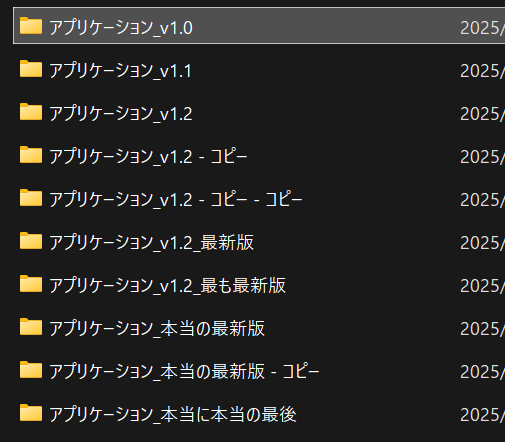
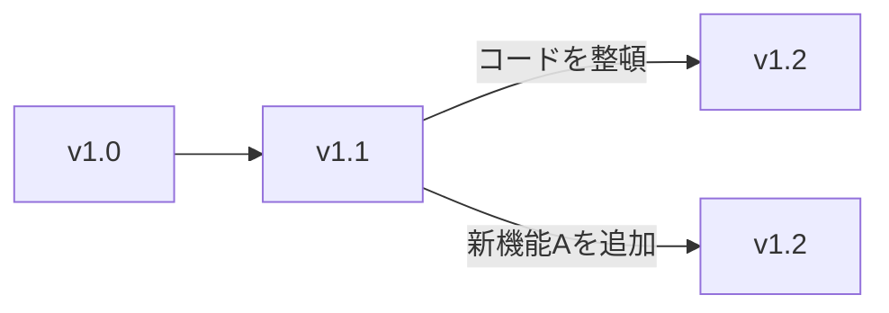
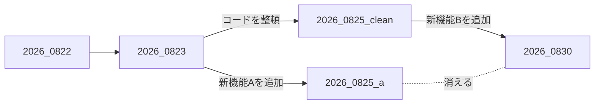

## Git を使いたい背景

### どれが最新かわからない状態

はじめに、こちらの画像をご覧ください。

コピーや正式なバージョン付けができなかったために、どれが本当の最新なのかがわからなくなってしまいました。

また、次のグラフをご覧ください。

上の v1.2 ではコード整理を、下の v1.2 では新機能Aの追加と、別のことを行っていますが、名前が被っています。

1人で開発している場合は、自分で命名規則を考え、それに則れば特に問題は起こりません。しかし、複数人で開発している場合は命名規則を忘れてしまったり、それを守っていても名前が重複する可能性が生まれます。

### 進捗の喪失

続いて、次のグラフをご覧ください。

ここでは、別々の人が開発したことによって、片方の作業結果 (新機能A) が本体に統合されることなく、消えてしまいました。

## Git を導入する

このような問題の解決に役立つのが、バージョン管理システム **Git** です。

Git を含めたバージョン管理システムには、主に3つの機能があります。

1. ファイル共有
1. ファイル同期
1. ファイルバックアップ

詳しく解説します。

### ファイル共有

チームで開発する際、ファイル共有をスムーズに行う必要があります。

GitHub (後々紹介します) を用いることで、クラウドでファイルを管理でき、開発者ごとにファイルのやり取りを行う必要がなくなります。また、変更点についてもわかりやすく表示できるため、複数人でそれぞれ違う開発作業を行った場合も統合を容易に行えます。(先述した"進捗の喪失"も防ぐことができます)

### ファイル同期

チームで開発する際、開発状況をチームで同期する必要があります。Git はこれを便利に行える機能が備わっています。先述した、"最新版"がどれかわからない、という問題もなくなるため、スムーズに開発を進めることができます。

### ファイルバックアップ

開発を行う際、"前のほうが良かった"という状況が発生することがあります。Git はバックアップ機能を備えており、昔の状態に簡単に戻すことができます。また、開発者が間違えてコードの一部や、プロジェクト全体を消してしまっても復旧しやすいというメリットもあります。

## Git の難しい点

Git は仕組みがやや難しいです。その原因は主に2つです。

1. コマンド (CLI) 操作が基本である点: 本資料ではコマンド操作をほとんどなくし、VSCode を用いた GUI 操作に絞ることで、学習しやすくしています。
1. 概念が新しい: バージョン管理という概念に触れたことがある人は少ないと思います。本資料では、初学者でもわかりやすい説明を心がけています。

本資料では、できるだけわかりやすいように画像を多めに、言葉も身近な用語を選択しました。参考になると嬉しいです。

## まとめ

開発にバージョン管理システム Git を導入することで、開発記録を残すことや、共同開発でのコードの統合を円滑にすることができます。

紹介した他にも開発を支援する様々な機能があり、それらを使いこなすことで、効率的で安全に開発を進めることができるでしょう!

### 参考

- [Git とは - GitLab](https://about.gitlab.com/ja-jp/blog/what-is-git/)
