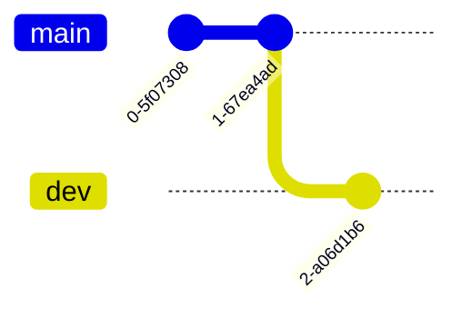
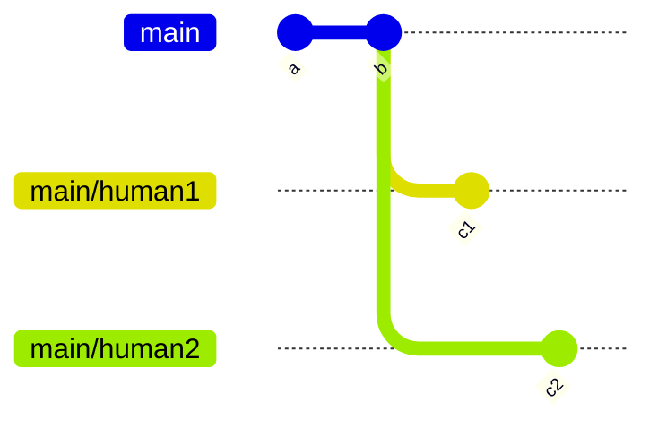

## ブランチとは

Git は複数人での開発を想定しています。複数人がそれぞれ別のコミットをすると、リモートに上げる際に干渉してしまいます。[^commit-remote]

そこで、**ブランチ**という機能が重要になります。

[^commit-remote]: そのまま開発することもできますが、手動で分離したほうが後から見た際にわかりやすいです

**ブランチ** (枝) を作成することによって、
