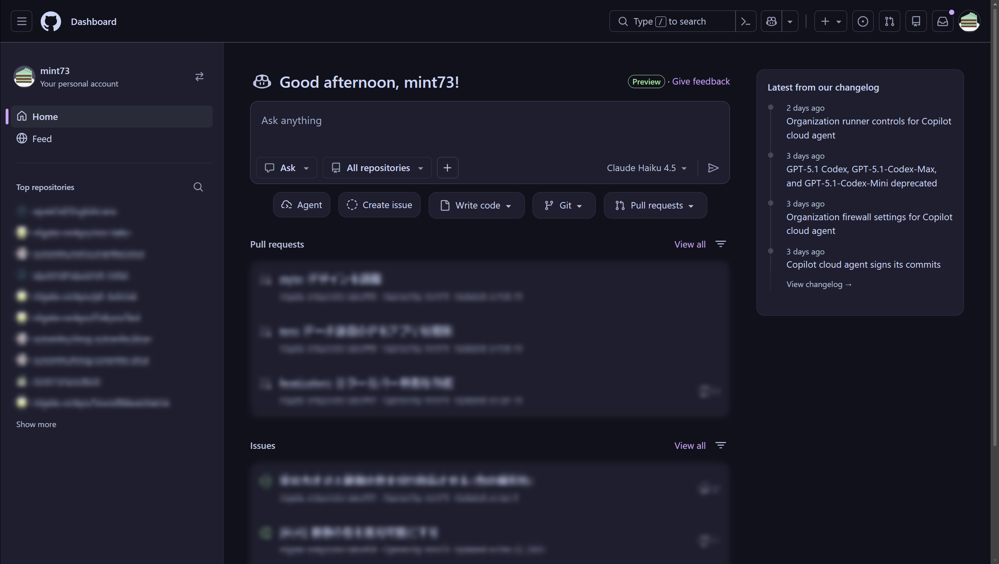
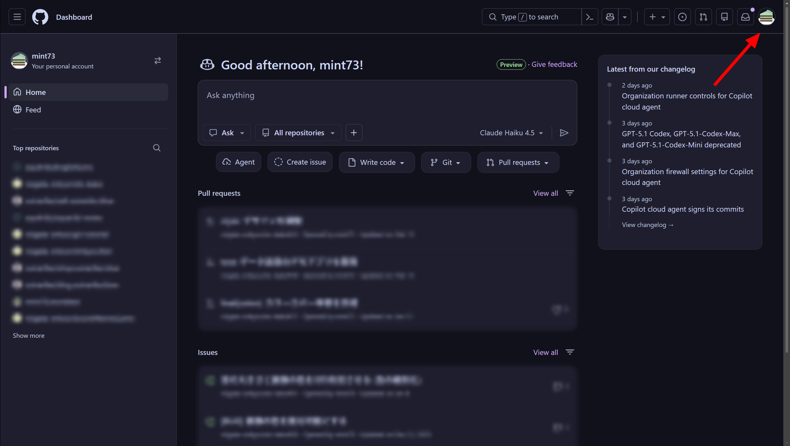
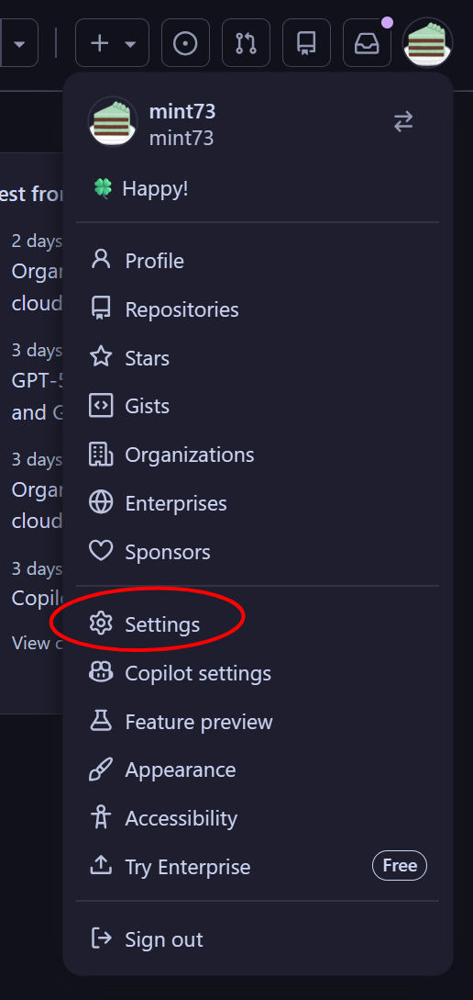
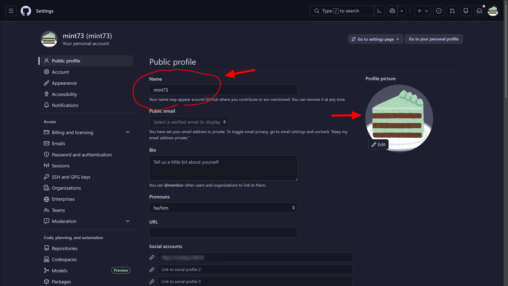

このページでは、GitHub アカウントの設定についていくつか紹介します。

(ちなみに、GitHub は**完全に英語サイトです**。日本語表示にできません (???)[^lang])

[^lang]: 日本人として、GitHub の難易度高い理由の1つがこれですね

## 1. GitHub のトップページ

GitHub のトップページを開きます。

<https://github.com>

こちらの画面が表示されます。

## 2. 設定ページを開く

右上のアイコンをタップします。

サイドバーが開くので、Settings を開きます。

## 3. 名前・アイコン設定

表示された部分で名前とアイコンを設定できます。わかりやすい名前に変えておきましょう。

